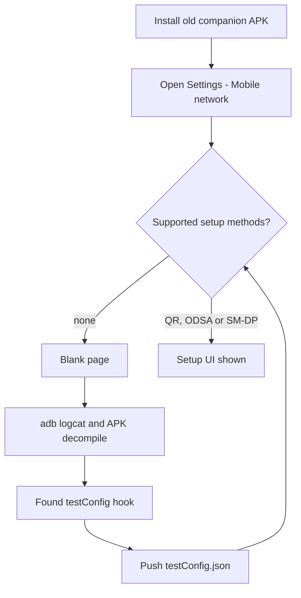
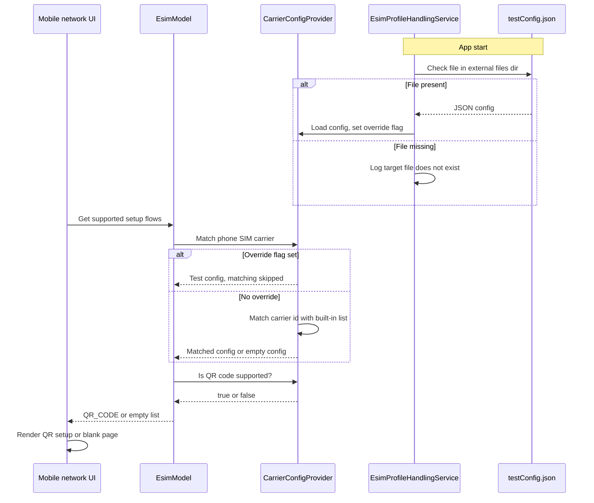
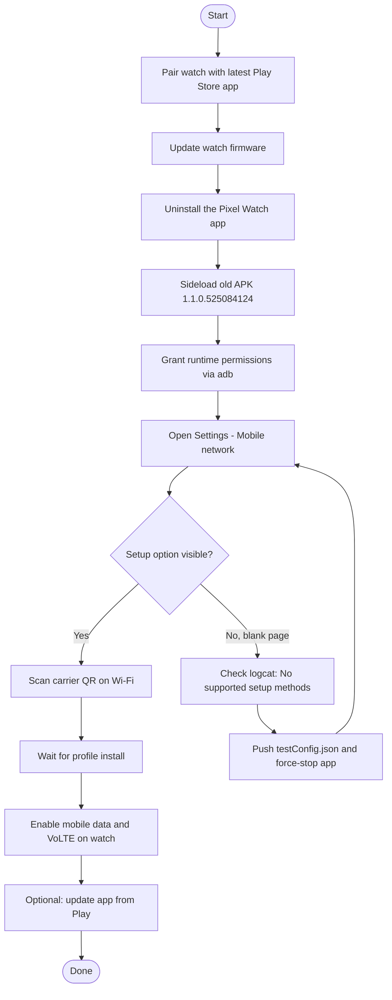

# Adding eSIM to a Pixel Watch 5 with an "unsupported" carrier

> Tested: Pixel Watch 5 (LTE) + Pixel 9 Pro, Android 17 (SDK 37), Pixel Watch companion app `1.1.0.525084124`, carrier Orange Poland (Orange Flex, separate eSIM QR code for the watch).
>
> Result: the "Mobile network" page that was blank now offers QR-code eSIM setup, and the eSIM was added successfully. After that the app was updated to `5.1.0.1005629187` from Play Store; the watch's mobile network keeps working.

This write-up explains **why** the well-known "sideload an old Pixel Watch app" trick can still fail (blank *Mobile network* page), **how** I found the root cause with `adb logcat` and decompilation, and **how** to force-enable the QR-code flow with a tiny JSON file that the app reads from its own storage. No root, no APK patching.

## Is this your problem?

You have an LTE Pixel Watch and a separate eSIM QR code from your carrier for the watch, and you see one of these:

- The Pixel Watch app says something like *"Your carrier in your country isn't supported"* / *"Mobile network isn't available"*.
- You sideloaded an old Pixel Watch app (`1.1.0.506033635`, `1.1.0.525084124`) as the XDA/Reddit guides describe, but **Settings > Mobile network is blank**: no toggle, no "Add plan", no QR option.
- `adb logcat` shows `ODSA not supported with current carrier`, `No supported setup methods for -1` or `eSIM setup not allowed, skipping eSIM setup step`.

Then [jump to the TL;DR](#tldr).

## Reported working

| Watch | Phone / Android | App build used for setup | Country / carrier | Result |
|---|---|---|---|---|
| Pixel Watch 5 LTE | Pixel 9 Pro / Android 17 | `1.1.0.525084124` + `testConfig.json` | Poland / Orange (Orange Flex) | eSIM added, LTE works; later updated to `5.1.0.1005629187` |

Tried it? Please [open a report](../../issues/new/choose), whether it worked or not, so this table can grow.

---

## Disclaimer

- This is for people who own both the phone and the watch, and who already have a legitimate eSIM / activation QR code from their carrier for the watch (a *separate* profile, not the phone's one).
- It does **not** bypass carrier authorization. The carrier still has to issue a profile for the watch. If your carrier does not provide a wearable/secondary eSIM QR code, nothing here will help.
- Not affiliated with Google. The app and watch are Google's. Do not redistribute APKs; download them from a source you trust and verify the signature.
- Nothing in the APK is modified. The override file is an undocumented debug/test hook that the app itself reads.
- Use at your own risk. Mobile-network behaviour (VoLTE, calls, SMS) is carrier-dependent.

---

## TL;DR

1. Pair the watch with the **latest** Pixel Watch app from Play, update the watch, then uninstall the app.
2. Sideload `1.1.0.525084124` (the build from the XDA / Reddit recipe) and grant its runtime permissions (Bluetooth, phone, camera, ...).
3. Open **Mobile network**. If it is **blank**, the app decided "no setup methods for your phone's carrier".
4. Push this file to the app's external files dir and restart the app (replace `1659` with your phone's carrier ID, see [Step 3](#step-3---read-the-log-around-the-blank-page)):

```bash
cat > testConfig.json <<'EOF'
{
  "carrier_id": 1659,
  "display_name": "My carrier",
  "setup_mechanisms": [0]
}
EOF

D=/storage/emulated/0/Android/data/com.google.android.apps.wear.companion/files
adb shell "mkdir -p $D"
adb push testConfig.json $D/testConfig.json
adb shell am force-stop com.google.android.apps.wear.companion
```

5. Re-open the app, go to **Mobile network**, choose **QR code**, scan the carrier's QR code with the watch on Wi-Fi.
6. Optionally update the app from Play afterwards (see [After the eSIM is added](#after-the-esim-is-added-updating-to-the-latest-companion-app)).

`setup_mechanisms: [0]` means *QR_CODE* only. See [the schema](#testconfigjson-schema-as-found-in-the-decompiled-app).

Shortcut: [`push-config.sh`](push-config.sh) does steps 2 (permissions) and 4 in one go: `./push-config.sh 1659 "My carrier"`, or `./push-config.sh --file testConfig.example.json`. [`testConfig.example.json`](testConfig.example.json) is the exact file that worked for me. On the phone the file must be named `testConfig.json` (case-sensitive); the local file name can be anything.

---

## Background

### The original trick

On many Pixel Watch generations, in countries/carriers that Google does not officially list, the current companion app hides the eSIM/mobile-network setup ("carrier in your country isn't supported"). The community workaround (XDA thread *"Pixel Watch 2 LTE in unsupported country"*, and a Reddit r/PixelWatch thread for Watch 4 in Poland):

1. Pair the watch with the latest Play Store app so the watch is fully set up and updated.
2. Remove the companion app.
3. Install an old companion build (`1.1.0.506033635` or `1.1.0.525084124`) that still has a QR-code eSIM entry.
4. Put the watch on Wi-Fi, scan the carrier's QR code.
5. Reinstall the latest app from Play.

### What went wrong

On Pixel Watch 5 + Android 17 the old app installed, paired state was visible and all settings pages worked, **but the Mobile network page was empty** (no toggle, no "Add plan" - nothing). It did not crash.

---

## Investigation

### High-level flow



### Step 0 - Tooling

macOS (Homebrew) was used; Linux/Windows equivalents work the same.

```bash
brew install --cask android-platform-tools   # adb
brew install jadx                     # decompiler
adb devices                           # enable Developer options > USB debugging first
```

Note: macOS has no `timeout` command, so run `logcat` in the background and kill it:

```bash
adb logcat -c
(nohup adb logcat -v threadtime > /tmp/pw.log 2>&1 &)
# ... reproduce the issue ...
pkill -f 'adb logcat'
```

### Step 1 - Verify the installed build

```bash
adb shell dumpsys package com.google.android.apps.wear.companion \
  | grep -E "versionName|versionCode|targetSdk|minSdk|firstInstallTime"
```

Result: `versionName=1.1.0.525084124`, `versionCode=330690344`, `minSdk=26`, `targetSdk=33`. So it was the right build, and the wrong-version theory was ruled out.

### Step 2 - Look at permissions

The first log showed a `SecurityException` for `BLUETOOTH_CONNECT`: after the sideload the old app had not been granted its runtime permissions (`dumpsys package` showed `granted=false`). I granted them explicitly (same command as in [recipe step 4](#full-step-by-step-recipe)), then force-stopped the app.

This removed the exception, but the page was **still blank** - so permissions were necessary hygiene, not the root cause. The camera permission is needed later anyway to scan the QR.

### Step 3 - Read the log around the blank page

No `FATAL EXCEPTION`, no ANR. Instead there was a consistent chain of `Esim.Device` messages:

```
WatchApi:         Found 1 watch configs
EsimCommunicator: eSIM device info: EsimDeviceInfo(eid=..., imei=..., model=Pixel Watch 5, manufacturer=Google)
EsimModel:        installed profiles data is not ready yet
CarrierConfigProvider: Search matching config with sim carrier id: 1659
StartupListener:  ODSA not supported with current carrier, skipping activation update.
EsimModel:        Getting supported flows for -1
EsimModel:        No supported setup methods for -1.
EsimModel:        eSIM setup not allowed, skipping eSIM setup step
```

Interpretation:

- The app **does** see the watch and **does** read its eSIM info (EID, model `Pixel Watch 5`). So it is not a "watch not recognised" problem.
- It then looks at the **phone's** active SIM (here: carrier ID 1659 = Orange Poland), tries to match that against an embedded list of carrier configurations, finds **no match** (`-1`) and computes **zero** supported setup methods.
- "No setup methods" -> "eSIM setup not allowed" -> the page renders nothing. It is a feature gate, not a crash.

You can find your own phone carrier ID in the same log line (`sim carrier id: <N>`). `adb shell dumpsys telephony.registry | grep -i carrierid` may also show it, depending on the Android version.

### Step 4 - Notice the test-config hook in the log

Early in each app start:

```
Esim.Test: [JsonTestConfigParser] Parsing from file: /storage/emulated/0/Android/data/com.google.android.apps.wear.companion/files/testConfig.json
Esim.Test: Target file ... does not exist
```

The app was **looking for a file that it supports as an override**.

### Step 5 - Decompile and confirm the schema

```bash
# pull the installed APK
adb shell pm path com.google.android.apps.wear.companion
adb pull /data/app/.../base.apk /tmp/apk/base.apk

mkdir -p /tmp/apk/dex && cd /tmp/apk/dex
unzip -o ../base.apk 'classes*.dex'

# quick strings check
strings -n 3 classes*.dex | grep -iE "testConfig|JsonTestConfigParser|setAvailableSetupMethods"

# full decompile
cd /tmp/apk && jadx -d out --no-res --no-debug-info -q dex/classes*.dex
grep -rl "testConfig.json" out/sources
```

Findings (most classes are obfuscated; below, `CarrierConfigProvider` / `EsimModel` are the log tags, the obfuscated class and method names are those of the 1.1.0.525084124 build):

- `com.google.android.libraries.wear.companion.esim.service.EsimProfileHandlingService.onStartCommand()` builds `File(getExternalFilesDir(null), "testConfig.json")`. If it exists, it parses it with `org.json` into a carrier configuration object and passes it to `CarrierConfigProvider` (class `kda`, method `t(config)`).
- `t()` stores that config and sets a flag (`d = true`). The method that matches the phone's SIM against the built-in carrier list (`v(...)`) starts with `if (this.d) return;`. **So once a test config is loaded, the real SIM matching is skipped completely.**
- `EsimModel` (class `kfk`, computes the supported flows) then reads capabilities from that config:
  - `E()` -> config's `setup_mechanisms` contains `QR_CODE` -> adds the QR flow (if the watch has no already-matching installed profile);
  - `D()` -> contains `ODSA` -> adds the ODSA flow (only if model/manufacturer present);
  - `A()`/`B()` -> `DEFAULT_SMDP` / `DEFAULT_SMDS`.



### Step 6 - Apply the override

Pushed the file (see TL;DR), force-stopped and restarted the app. The log changed from

```
Getting supported flows for -1
No supported setup methods for -1.
```

to

```
Getting supported flows for 1659
device is allowing eSIM setup by Qrcode. not subscribed : true, carrier support qr code: true
```

and the Mobile network page showed the QR-code setup option. Scanning the carrier QR code with the watch on Wi-Fi installed the profile.

> Observation: the log also shows a second line `Getting supported flows for -1` from a different process of the same app. Only the main (UI) process matters for rendering; the UI did show the setup option.

---

## `testConfig.json` schema (as found in the decompiled app)

All keys are optional - missing ones fall back to the defaults below. Parsed using `org.json` `optString/optBoolean/optInt/optJSONArray`.

| Key | Type | Default | Notes |
|---|---|---|---|
| `specification` | string | `""` | ODSA protocol family. Recognised by the app: `MVS_V1`, `Samsung`, `TS43_V1`, `Ericsson`. Anything else = generic. Not needed for QR-only |
| `carrier_id` | int | `-1` | Android `TelephonyManager.getSimCarrierId()` value. Shows up in logs (`Getting supported flows for <id>`). Using your real carrier id is cleanest; value `1989` is special-cased (Google Fi) in the app, avoid it |
| `display_name` | string | `""` | Shown in UI strings |
| `ess_endpoint_url` | string | `""` | ODSA only |
| `fcm_sender_id` | string | `""` | ODSA only |
| `support_number` | string | `""` | Shown as carrier support number |
| `support_url` | string | `""` | |
| `app_url` | string | `""` | Carrier app link |
| `app_parameter_value_override` | string | `""` | |
| `default_smdp_address` | string | `""` | Needed for default SM-DP flow |
| `voice_twinning_enabled` | bool | `false` | |
| `message_twinning_enabled` | bool | `false` | |
| `check_eligibility_without_auth` | bool | `false` | |
| `carrier_additional_service` | string | `""` | |
| `reboot_needed` | bool | `false` | |
| `manage_subscription_supported` | bool | `false` | |
| `cellular_only_access` | bool | `false` | |
| `carrier_additional_app_preinstalled` | bool | `false` | |
| `service_provider_names` | string[] | none | Only used by the built-in matching, which is skipped when this file is used |
| `mccmnc_tuples` | string[] | none | Same as above |
| `setup_mechanisms` | int[] | `[0, 1]` (QR_CODE, ODSA) | Index into enum `{0: QR_CODE, 1: ODSA, 2: DEFAULT_SMDP, 3: DEFAULT_SMDS}` |
| `auth_mechanisms` | int[] | `[OIDC]` | Index into an auth enum, only relevant for ODSA |
| `whitelisted_urls` | string[] | none | ODSA web view allow-list |

For the QR-only case, this minimal file should be enough:

```json
{ "carrier_id": 1659, "display_name": "Orange PL", "setup_mechanisms": [0] }
```

The file I actually used additionally contained `"specification": ""`, `service_provider_names` and `mccmnc_tuples`. Per the code these are ignored once the override flag is set, but the minimal variant itself was not tested.

> Caveat: if `setup_mechanisms` is omitted, the default `[0, 1]` also enables ODSA, which cannot work without the ODSA endpoint keys. Set `[0]` explicitly.

---

## Full step-by-step recipe

### Prerequisites

- Phone with USB debugging enabled and `adb` working (`adb devices` shows it as `device`).
- Watch with eSIM hardware (LTE model, e.g. Pixel Watch 5 LTE).
- Carrier-issued **separate** eSIM QR code (or SM-DP+ activation code) for the watch.
- Wi-Fi network the watch can join.

### Procedure



1. **Pair with the latest app.** Install the current Pixel Watch app from Play, pair the watch, finish setup and let the watch update.
2. **Uninstall the app.** The watch stays paired/bonded; the old app picks up the existing pairing when it starts.
3. **Install the old build.** Settings > Apps > Special access > Install unknown apps for your file manager, or:
   ```bash
   adb install -r pixel-watch-1.1.0.525084124.apk
   ```
   Disable Play auto-update for the app so it does not get replaced mid-procedure.
4. **Grant permissions.** A sideloaded install starts with all runtime permissions denied and the old app does not reliably request them; Bluetooth is needed to talk to the watch, the camera to scan the QR:
   ```bash
   P=com.google.android.apps.wear.companion
   for p in BLUETOOTH_CONNECT BLUETOOTH_SCAN READ_PHONE_STATE POST_NOTIFICATIONS \
            ACCESS_FINE_LOCATION ACCESS_COARSE_LOCATION CAMERA; do
     adb shell pm grant $P android.permission.$p
   done
   ```
5. **Open the app -> Mobile network.**
   - If setup options are present, skip to step 8.
   - If the page is empty, verify the gate:
     ```bash
     adb shell am force-stop $P
     adb logcat -c
     (nohup adb logcat -v threadtime > /tmp/pw.log 2>&1 &)
     # open app > Mobile network
     pkill -f 'adb logcat'
     grep -E "Esim\.(Device|Test)" /tmp/pw.log | cut -c1-250
     ```
     Expect `No supported setup methods for -1` and `Target file ... testConfig.json does not exist`.
6. **Create the override file** (use your own `carrier_id` from the log line `sim carrier id: <N>`):
   ```bash
   cat > testConfig.json <<'EOF'
   {
     "carrier_id": 1659,
     "display_name": "My carrier",
     "setup_mechanisms": [0]
   }
   EOF
   ```
7. **Push it and restart the app:**
   ```bash
   D=/storage/emulated/0/Android/data/$P/files
   adb shell "mkdir -p $D"
   adb push testConfig.json $D/testConfig.json
   adb shell am force-stop $P
   adb shell monkey -p $P -c android.intent.category.LAUNCHER 1
   ```
   Verify in the log: `Getting supported flows for <id>` followed by `device is allowing eSIM setup by Qrcode`.
8. **Scan the QR** from the carrier with the watch on Wi-Fi and close to the phone. Wait for the profile to install and activate.
9. **After activation:** on the watch enable mobile data and VoLTE/Wi-Fi calling if calls or SMS don't work; it can take several hours (up to ~24h in community reports) for the carrier to finish provisioning. Many carriers require the phone and watch to be on the same carrier network for full calling/SMS.
10. **Optional:** update the app from Play and remove `testConfig.json` - see [After the eSIM is added](#after-the-esim-is-added-updating-to-the-latest-companion-app).

---

## Troubleshooting

| Symptom | Likely cause | Fix |
|---|---|---|
| Page still blank after pushing the file | App not restarted, or file not readable | `adb shell ls -l $D`, `force-stop` and relaunch; look for `Parsing from file:` and `Error parsing test config JSON` in logcat |
| `Error parsing test config JSON` | Invalid JSON / wrong types | Validate with `jq . testConfig.json` |
| `adb push` fails: no such directory | App has never created its external dir | `adb shell mkdir -p $D` first (included in step 7) |
| Can't write to `Android/data` from the phone | Android 11+ blocks on-device file managers from that folder | Use `adb push` as in this guide |
| `SecurityException ... BLUETOOTH_CONNECT` in log | Runtime permission not granted | `pm grant` as in step 4 |
| Log: `no eSIM device information, either the watch is not an eSIM supported watch or data items have not been synced yet` | Watch not synced / not an eSIM model / app can't read watch data | Keep watch connected, re-open app, verify the watch has eSIM hardware |
| Log: `watch already has a matched profile installed` | A profile for this carrier is already on the watch, so the QR flow is not offered | Nothing to add. Delete the profile on the watch only if you really need to re-provision - QR codes are usually single-use, so get a new one from the carrier first |
| QR scan fails / "can't add" | Carrier QR is for the phone, not a *secondary* device profile, or is already consumed | Ask the carrier for a new wearable/secondary eSIM QR |
| Works but no calls/SMS | VoLTE not enabled / carrier provisioning delay | Enable VoLTE on the watch; wait; confirm multi-device support with carrier |
| `SdkCapabilitiesStartup: Failed. Retrying...` in log | Not investigated | Harmless in my case |

---

## Why this works (summary)

- The old companion app gates the eSIM setup UI on a built-in list of known carriers, matched against the **phone's** SIM carrier ID. No match -> no setup methods -> blank page.
- The same app has a test hook that loads a carrier configuration from `getExternalFilesDir()/testConfig.json` and skips the matching.
- With `setup_mechanisms: [0]` the QR-code flow is offered; the actual profile download is done by the watch's own eSIM stack (LPA), so what ultimately matters is that the carrier accepts the QR.

---

## After the eSIM is added: updating to the latest companion app

Once the profile is installed on the watch, the old build is no longer needed. I updated in place from Play to the latest build and re-checked.

### What I observed

| Item | Value |
|---|---|
| Updated build | `5.1.0.1005629187` (versionCode `331757321`, minSdk 30, targetSdk 37, installer `com.android.vending`) |
| Cellular network on the watch | Works as expected |
| Mobile network page in the phone app | Opens (no longer blank); the installed eSIM profile is listed and can be managed (e.g. update option available) |
| `testConfig.json` | Left in place; the new build still parses it (`Esim.Test: [JsonTestConfigParser] Parsing from file ...` and `[EsimModel] Using test config, return first active subscriptions`) |

Relevant log lines from the new build (all consistent with a healthy install):

```text
Esim.Device: [EsimCommunicator] Return installed profiles: [WatchProfileInfo(iccid=89480...XXXX, carrierId=1659, carrierName=Orange, mccMnc=26003, enabled=true, downloaded=true)]
Esim.Device: EsimDeviceInfo(... model=Pixel Watch 5, manufacturer=Google, internalModelCode=wisteria_lte)
[CarrierConfigsProvider] Found 72 carrier configurations for model wisteria_lte
[EsimSetupCardListener] enabledProfiles: There are 1 enabled profiles
[EsimAvailableUseCase] esimAvailable: true
[Spacetime][EligibilityUseCase] Esim already on watch.
[EsimModel] No supported setup methods for 1659.     <- expected: profile already installed, QR "add" flow is not offered again
```

Take-aways:

- The new app recognises the watch (`wisteria_lte`), sees the profile as installed **and enabled**, and treats eSIM as available. The cellular service itself does not depend on this page.
- "No supported setup methods" only means the app will not offer to add a *new* profile for this carrier. It does not affect the installed one.

### Cleanup after the update

- `testConfig.json` was only needed to unlock the setup flow. The new build still reads it (`Using test config, return first active subscriptions`), so removing it returns the app to its normal logic:
  `adb shell rm /storage/emulated/0/Android/data/com.google.android.apps.wear.companion/files/testConfig.json`
- Do not remove the plan from the watch via the new app, and do not factory-reset the watch, unless you intend to repeat the whole procedure.
- Re-enable Play auto-update for the app if you disabled it.

---

## Limitations / what is not verified

- Verified only with companion `1.1.0.525084124` (setup) and `5.1.0.1005629187` (after update) on Pixel 9 Pro (Android 17) + Pixel Watch 5, carrier Orange Poland.
- Other app builds may have a different hook, different file name, or no hook at all. Check with `strings classes*.dex | grep -i testConfig`.
- Not isolated: whether the `pm grant` step is required for the QR flow (beyond the camera), and whether the minimal `testConfig.json` works as well as the file I used.
- Class names are obfuscated and will differ between builds; use the log strings as anchors when searching.
- Google can change behaviour server-side or in the watch firmware at any time.

## References

- XDA thread: ["Pixel Watch 2 LTE in unsupported country"](https://xdaforums.com/t/pixel-watch-2-lte-in-unsupported-country.4637402/)
- Reddit r/PixelWatch: ["LTE in not supported country working for Watch4"](https://www.reddit.com/r/PixelWatch/comments/1o2f7yl/lte_in_not_supported_country_working_for_watch4/)
- [Google: Pixel Watch compatibility and LTE carriers](https://support.google.com/googlepixelwatch/answer/12652073)
- [APKMirror, Google Pixel Watch (`com.google.android.apps.wear.companion`)](https://www.apkmirror.com/apk/google-inc/google-pixel-watch/)
- [jadx](https://github.com/skylot/jadx)
